本项目为面向多酒店的在线预订系统，项目甲方为符子建（241220165），项目仓库为 <https://github.com/yangjinlingzhuo/se-lab1-hotel-booking>。本报告以实验一确认的 REQ-001～REQ-025 为设计依据，完成系统模块划分、领域模型、订单状态机、核心业务交互及界面原型设计，为后续实现提供架构和交互基线。本阶段不涉及在线支付、第三方预订平台、会员积分、智能门锁、动态定价及具体房间分配。

## 一、软件的主要功能

系统服务于顾客、酒店工作人员和平台管理员。顾客完成酒店查询、报价确认、预订及订单管理；酒店工作人员维护本店资源并处理订单履约；平台管理员维护酒店及工作人员账号。公开查询无需登录，涉及订单和管理数据的操作须通过身份认证与权限校验。系统功能划分如下。

1. **账户与权限。** 顾客、所属酒店工作人员、平台管理员三种角色。工作人员账号由管理员开通，不能自行注册成管理员。密码只存摘要，电话按履约范围展示。
2. **酒店、房型与逐日库存价格。** 维护酒店营业状态、入住退房规则、房型及逐日价格和库存。房型采用停用而非物理删除；同一房型每日仅保留一条库存记录。可售量由容量、停售量、预订量和在住量计算，且不得为负。
3. **查询与报价。** 组合条件筛选，只返回每一个入住夜晚都可订、且人数不超承载的结果。价格标注为整个入住期间的单间总价。北京时间，入住日含、退房日不含。当日 14:00 之后不再开放当日网上新订。
4. **预订。** 顾客确认逐晚报价后提交订单。系统重新校验营业状态、价格和库存，并以单个事务完成订单创建和全入住周期的库存占用；任一晚校验失败均回滚。请求标识用于保证重复提交的幂等性。
5. **订单履约。** 酒店在三十分钟内确认或拒绝订单。确认不重复占用库存；拒绝、超时及符合条件的取消操作释放原占用。确认后的订单可依次办理入住和退房。未到店订单保留至入住日次日 02:00，由工作人员联系后处置。
6. **改订。** 联系人信息可直接修改；日期、房型和间数的变更须提交改订申请。同一订单同时最多存在一个待处理申请，审批期间原方案继续有效。批准时以事务方式完成新旧方案的库存差额替换。
7. **统计。** 按住宿日和房型分开统计。当前有效只计待确认、已确认、已入住的最新方案；历史只计已完成订单。预计金额取快照，不称实收。取消量按取消操作日另计。新旧方案不双计。
8. **日志。** 记录操作人、北京时间、酒店、对象、前后状态、结果、原因和请求标识。业务账号不能改日志，日志不记密码和完整证件。

订单状态包括待确认、已确认、已入住、已完成、已取消、已拒绝和已超时。系统仅执行状态机定义的合法转换；非法请求不改变订单和库存。

## 二、软件架构与 UML

本设计采用包图、类图、状态图和时序图，从系统结构、领域模型、对象行为和业务协作四个角度描述系统。包图用于说明模块边界与依赖方向；类图描述核心领域对象及关系；状态图约束订单生命周期；时序图展示查询、报价、库存占用和酒店确认之间的协作。

### 2.1 包图：模块划分与依赖

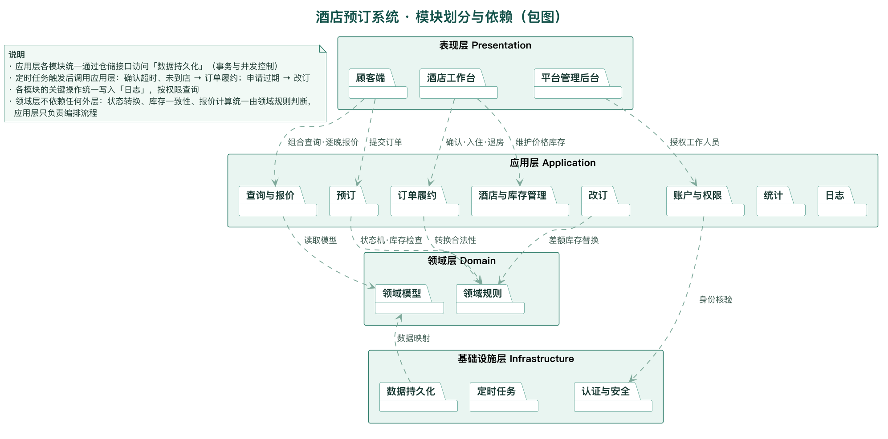{width=100%}

**图 1** 为结构类包图，系统采用表现层、应用层、领域层和基础设施层四层架构。

表现层按角色划分为顾客端、酒店工作台和平台管理后台，仅通过应用层访问业务能力，从结构上落实用户、酒店和平台之间的权限边界。应用层按业务用例划分为八个模块：查询与报价、预订、改订和订单履约组成核心业务流程；酒店与库存管理负责基础资料和可售资源；账户与权限、统计和日志提供通用能力。

领域层包含领域模型和领域规则，集中实现订单状态转换、逐夜可订校验、报价及改订库存替换，避免相同规则分散在多个应用服务中。基础设施层提供持久化、定时任务、认证与安全能力。应用层通过仓储接口访问数据，由持久化实现事务和并发控制；定时任务触发超时处理，但未到店订单仍须人工处置。图中以说明文字表达基础设施对上层流程的触发关系，以保持依赖方向清晰。

### 2.2 类图：领域模型

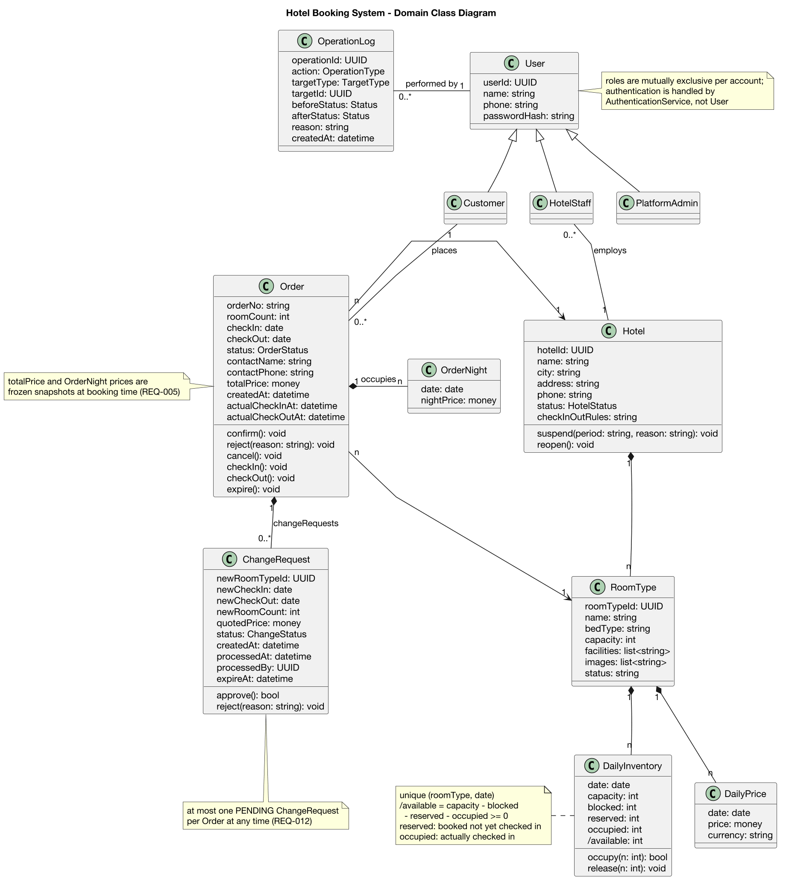

**图 2** 为领域类图，仅保留核心领域对象；仓储、控制器和界面类不纳入该图，以突出业务实体、属性和关联。

User 通过继承形成 Customer、HotelStaff 和 PlatformAdmin 三种互斥角色。登录校验由认证服务负责。HotelStaff 与 Hotel 通过 employs 关联表达所属关系，因此不在类中重复设置 hotelId。

Hotel 组合多个 RoomType，RoomType 分别组合 DailyInventory 和 DailyPrice，使库存变更与价格调整保持独立。DailyInventory 区分已预订未入住（reserved）和实际入住（occupied），可售量作为派生属性计算。同一房型与日期的组合具有唯一性。

Customer 与 Order 采用普通关联，以保证账号停用后历史订单仍可保留。Order 组合逐夜明细 OrderNight，保存每晚价格及订单总价快照，使后续调价不影响既有订单。计划入住日期与实际入住、退房时间分别记录。

Order 与 ChangeRequest 为一对多组合，同时通过约束限定同一订单最多存在一个待处理申请，从而兼顾当前业务限制与历史记录保留。申请记录新方案、报价、创建与处理信息。

操作日志关联到用户，字段包括动作类型、对象类型、对象标识和前后状态。日志不随用户删除而消失。

### 2.3 状态图：订单七状态

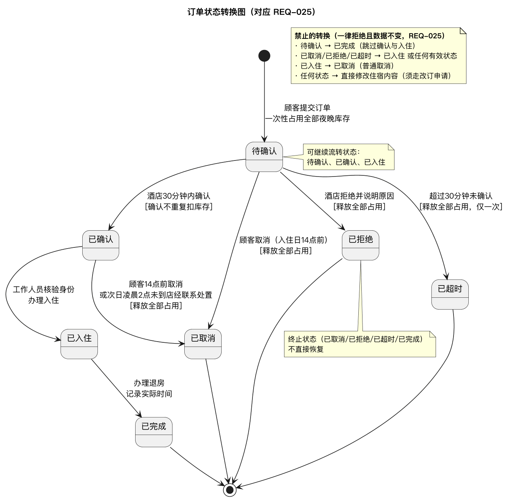{width=92%}

**图 3** 为行为类状态图，描述订单的完整生命周期。

正常履约路径为“待确认—已确认—已入住—已完成”。订单创建时一次性占用全部入住夜晚；酒店确认仅改变订单状态，不重复扣减库存。拒绝、确认超时和符合时限的顾客取消均进入相应终止状态，并以幂等方式释放库存。

“已确认—已取消”包含两类触发条件：入住日 14:00 前由顾客取消，以及次日 02:00 仍未到店时由工作人员联系并登记处置。后者不由确认超时任务自动执行。

已取消、已拒绝、已超时和已完成均为终止状态。状态机同时禁止待确认直接完成、终止状态转入入住、已入住后普通取消等非法转换；住宿方案变更由独立的改订流程处理。

### 2.4 时序图：顾客下单与酒店确认

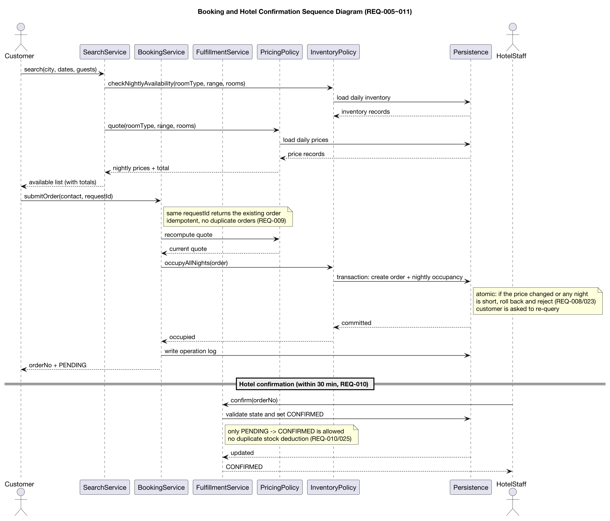{width=100%}

**图 4** 为交互类时序图，参与对象包括 SearchService、BookingService、FulfillmentService，以及领域规则中的 PricingPolicy 和 InventoryPolicy。

查询服务接收城市、日期和人数等条件，由库存策略逐夜校验可售量，报价策略汇总各晚价格并返回住宿期间总价。

提交订单时携带请求标识；重复请求返回既有结果，避免重复建单。预订服务重新计算报价，并在同一事务中创建订单和写入逐夜库存占用。若价格变化或任一晚库存不足，则整体回滚并要求重新查询；并发控制保证最后一间房仅被一个事务成功占用。

酒店工作人员通过履约服务确认订单。该操作仅接受“待确认—已确认”转换，并持久化确认结果，不再次占用库存。时序图以成功路径为主，事务回滚、幂等和确认不重复扣减库存作为约束注释；其他状态转换由状态图统一描述。

## 三、功能模块的界面

界面原型以“山吹宿泊”为视觉主题，覆盖顾客端、酒店工作台和平台管理后台。整体采用暖色背景与赭石色操作按钮，并通过状态提示、辅助说明和操作可用性呈现关键业务约束。

### 3.1 顾客端

**界面 1 登录与注册。** 登录身份在顾客、酒店工作人员、平台管理员之间切换。说明文字写明工作人员账号由管理员开通，浏览酒店和房型不必注册，提交订单前才引导登录。页脚标明密码加密存储和按角色隔离，对应 REQ-001、REQ-022。

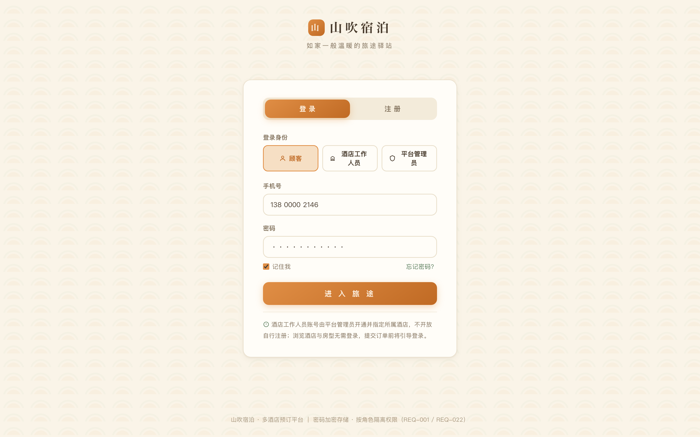{width=78%}

**界面 2 首页查询。** 条件是目的地、入住日、退房日、人数和住宿总价预算。辅助文案写清住宿夜数按「入住日含、退房日不含」计算，当日 14:00 后不开放当日网上新订，筛选结果必须整段日期都有余房。推荐卡片展示营业中与整备中，整备中的酒店不能直接当可订结果。

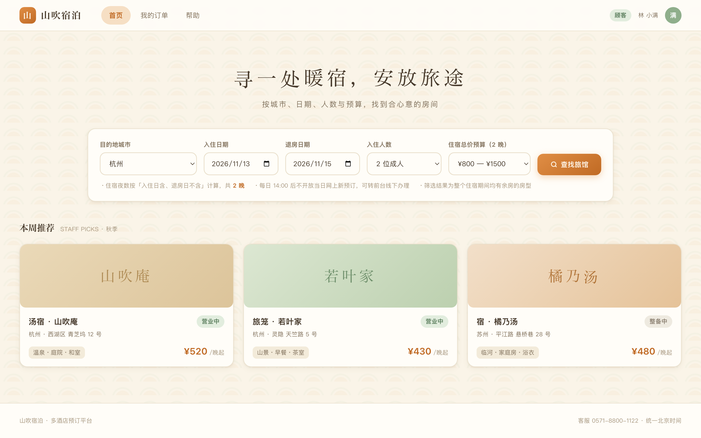{width=92%}

**界面 3 查询结果。** 保留查询条件，并支持按住宿总价排序及按房型、设施过滤。可订结果展示总价和逐晚价格；入住期间存在缺房日期的酒店仅作参考，不提供下单入口。

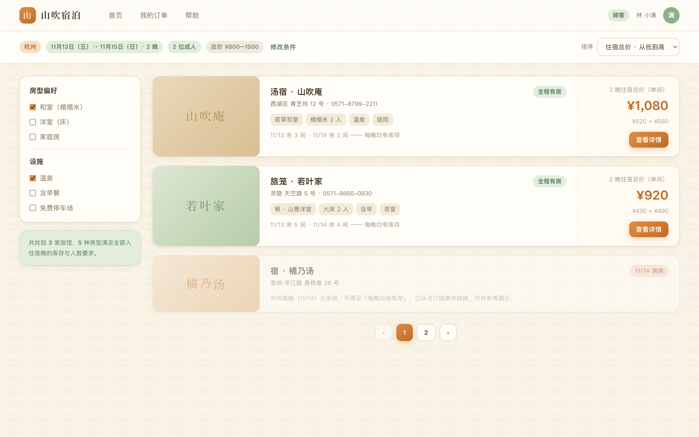{width=92%}

**界面 4 酒店与逐日价格。** 展示酒店地址、联系方式、入住退房时间及设施。房型按日列出单价、剩余间数和停售原因，汇总区显示所选日期的住宿总价；未完成逐日报价的房型不提供预订入口。

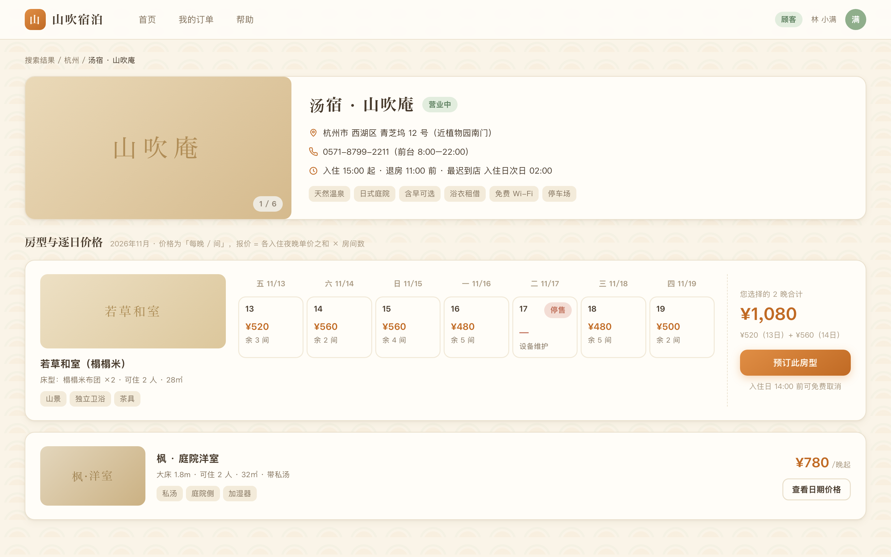{width=92%}

**界面 5 确认订单。** 联系人姓名和电话为必填项，费用区展示逐晚价格与合计。提交时再次校验库存和报价；预订须知说明确认时限、取消条件及价格快照规则。

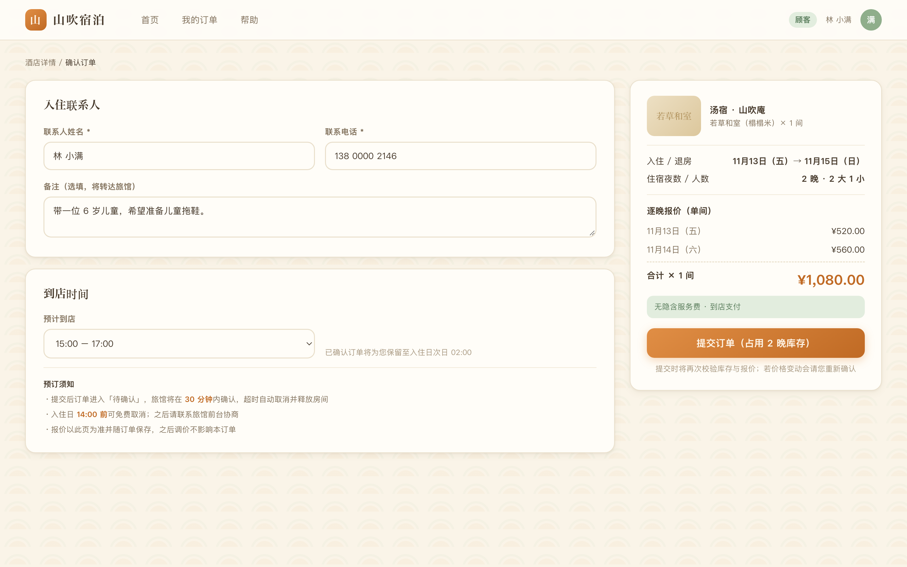{width=92%}

**界面 6 我的订单。** 仅展示当前顾客的订单，并支持按订单号、状态和入住日筛选。不同状态显示对应的剩余确认时间、取消期限、保留期限及可用操作，终止状态不再提供取消或改订。

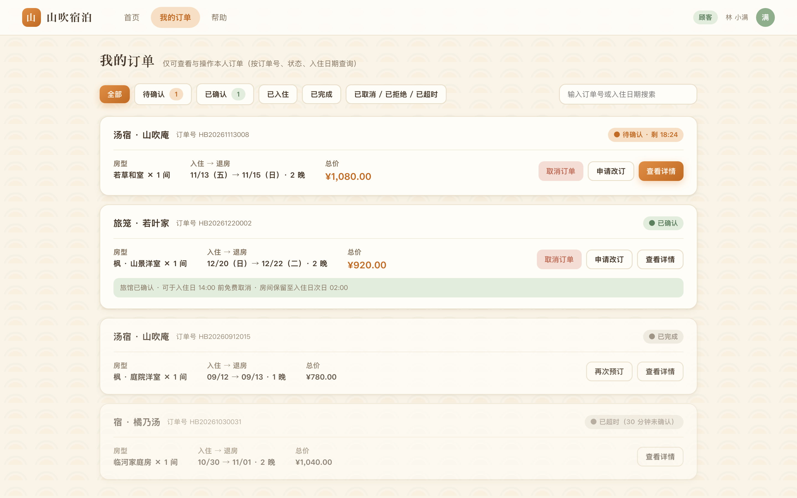{width=92%}

**界面 7 订单详情。** 以时间轴展示订单履约进度，并提供联系人修改、取消和改订入口。日期、房型及间数变更须提交改订申请；审核期间原方案有效，逐晚价格按下单快照展示。

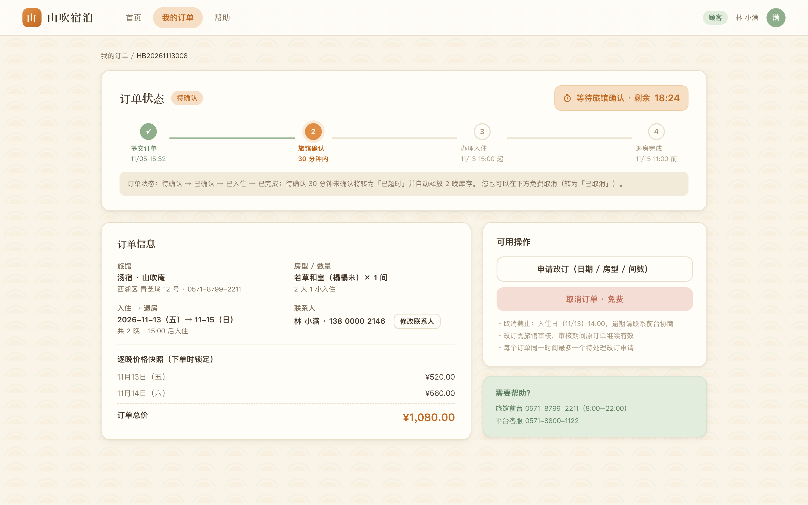{width=92%}

### 3.2 酒店工作台

工作台顶栏展示所属酒店和当前工作人员，侧栏提供今日概览、订单处理、改订审核、价格库存日历、停售与停业、预订统计和操作日志。本报告重点展示概览、订单处理、日历和统计四个代表性页面，其余功能沿用相同的导航和权限体系。

**界面 8 今日概览。** 汇总当日待入住、待退房、待确认订单和未到店预警。待确认订单提供确认与拒绝操作；未到店订单提供联系登记而非直接释放库存。页面同时展示房态、停售和待审改订信息。

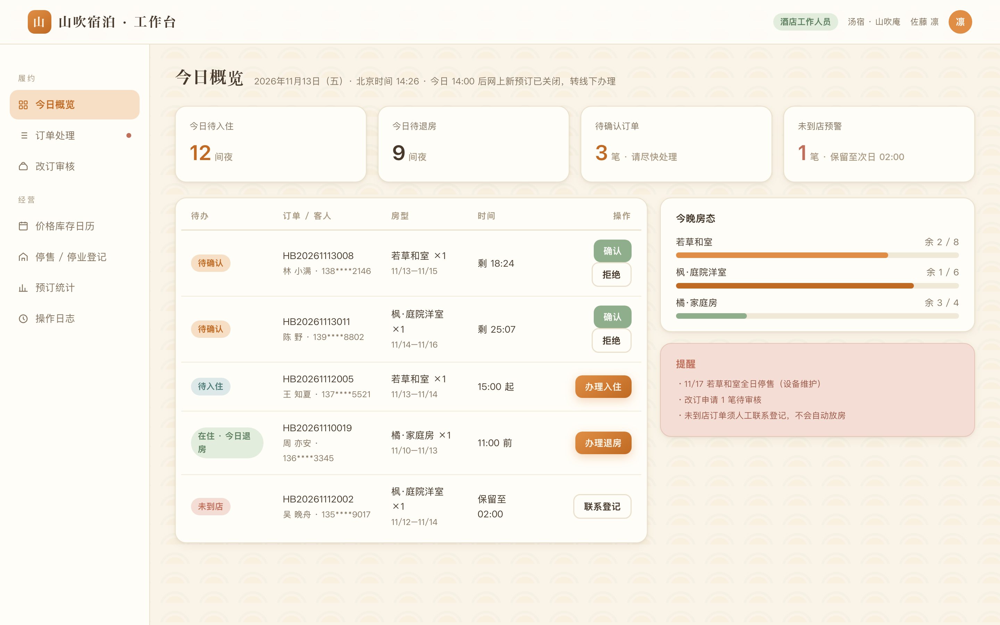{width=92%}

**界面 9 订单处理。** 列表仅展示本酒店订单，并按当前状态提供确认、拒绝、入住、退房、延住和未到店登记等操作。入住操作记录实际时间，敏感联系方式采用脱敏显示，关键操作写入日志。

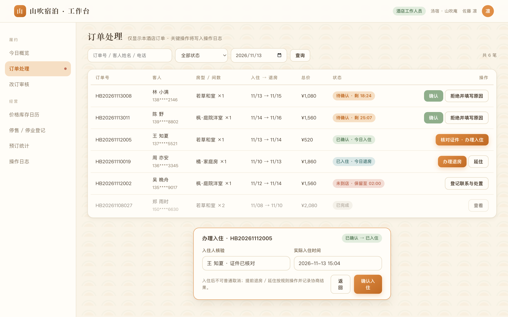{width=92%}

**界面 10 价格库存日历。** 按房型和日期展示单价、剩余间数及停售原因。编辑区显示已占用间数，并限制容量不得低于占用量；页面区分预订量与在住量，价格调整不影响既有订单快照。

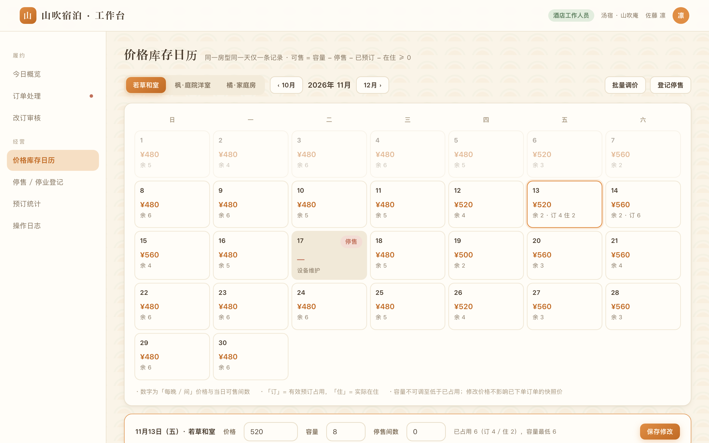{width=92%}

**界面 11 预订统计。** 分别展示当前有效订单与历史已完成订单。统计按住宿日和房型展开，预计金额采用订单快照，取消量按操作日单列；改订订单仅统计最新有效方案。

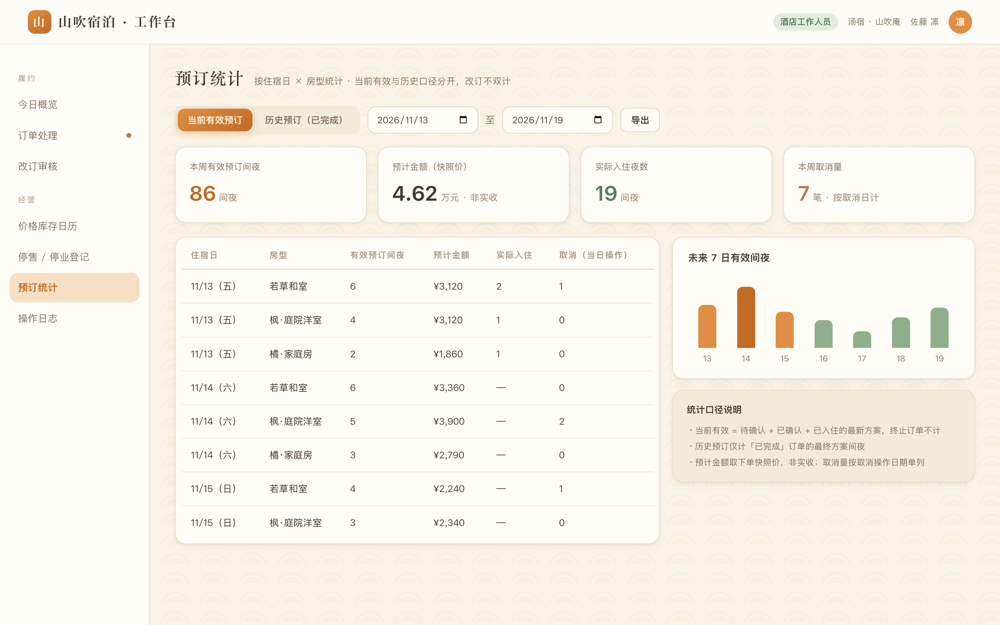{width=92%}

### 3.3 平台管理后台

**界面 12 酒店与工作人员。** 管理员维护酒店资料、营业状态和工作人员账号。存在历史订单的酒店采用停用方式管理；工作人员开户时须指定所属酒店和权限，并要求首次登录修改初始密码。

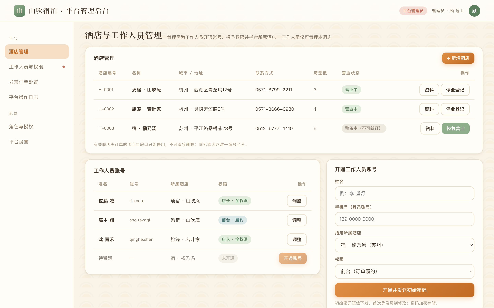{width=92%}

## 四、AI 辅助设计过程

本实验使用大模型辅助生成 PlantUML 初稿、调整图形样式并根据反馈修改源码。架构边界、领域关系和业务约束均由本人依据实验一需求审查确认；Git 提交记录区分 AI 初稿与人工反馈后的修订。UML 源码与过程材料见仓库 `docs/design/`。

### 4.1 包图

**使用场景。** 将 25 条需求归纳为系统模块及其依赖关系。

**生成结果。** 模型生成四层架构及八个应用模块，覆盖查询、预订、履约、库存、权限、改订、统计和日志。

**问题与修改。** 初稿存在别名显示、层级错位和依赖线过密等问题；隐藏布局约束还与可见依赖形成环，导致 Graphviz 渲染超时。修订时删除反向依赖，以注释说明定时任务的触发关系；同时统一浅青绿色彩，精简跨层连线并重新排列应用模块。

**优缺点。** 模型能够快速完成需求到模块的初步映射，并辅助分析渲染故障；但对 PlantUML 自动布局和依赖密度缺乏预判。最终由本人确认领域规则集中管理、表现层不得直接修改库存等架构约束。

### 4.2 类图

**使用场景。** 建立领域类图，表达核心数据关系和业务不变式。

**生成结果。** 初稿包含领域模型、领域规则和枚举，正确识别了用户继承、订单与逐夜明细、房型与每日库存等主要关系，但内容过多且布局松散。

**问题与修改。** 首先依据简约类图样例统一英文命名，删除策略类和枚举框，仅保留领域对象。随后根据书面审查意见修正三项关键语义：

- Customer 与 Order 由组合改为普通关联，确保账号状态不影响历史订单保留。
- ChangeRequest 的多重性由 0..1 改为 0..，并增加“同一时刻最多一个待处理申请”的约束。
- DailyInventory 分离 reserved 与 occupied，并将 available 定义为派生属性。

此外，删除 HotelStaff 中与关联重复的 hotelId，将日志字段类型化，补充订单实际入住和退房时间及价格币种，并将认证职责移出 User。

**优缺点。** 模型能够快速生成类、属性及多重性，并按样例统一表现形式；但初稿倾向于将外键、组合和计算字段直接纳入模型，可能造成语义错误。本人逐项对照需求后修正关系和约束，并按用户权限、预订、酒店、库存价格四个区域重排终稿。

### 4.3 状态图

**使用场景。** 行为类图选择状态图，表达 REQ-025。

**生成结果。** 初稿横向展示主履约路径，并分别放置提前终止状态；各转换标注触发条件和库存动作，同时列出禁止转换。

**修改。** 将标注统一为中文，并重点校验两项约束：确认操作不重复扣减库存；“已确认—已取消”同时覆盖规定时限内的顾客取消和未到店后的人工处置。三十分钟超时仅作用于待确认状态。

**优缺点。** 在状态及转换条件明确时，模型能够完整生成状态机；但容易将未到店错误处理为自动超时。本人依据 REQ-015 将其修正为联系顾客后的人工处置。

### 4.4 时序图

**使用场景。** 交互类图选择时序图，表达下单和酒店确认。

**生成结果。** 初稿包含顾客端和酒店工作台两个界面参与者，并以 alt 分支描述报价变化后的重新确认。

**修改。** 删除仅负责转发请求的界面参与者，使时序图聚焦角色与业务服务之间的协作。价格或库存校验失败统一回滚并返回重新查询提示，不再展开为重新确认分支。全图采用与类图一致的英文命名，失败处理、幂等及确认不重复扣减库存以注释表达。

**优缺点。** 模型善于完整展开异常分支，但容易使时序图信息过载。本人依据各 UML 图的职责分工保留核心成功路径，将异常规则交由注释和状态图表达。

### 4.5 报告整理与语言润色

**使用场景。** 在本人确定章节结构、设计结论和图文对应关系后，使用大模型辅助整理报告并统一措辞。

**生成结果与修改。** 初稿完整覆盖功能、UML、界面和 AI 使用过程，但部分表述偏口语化，并重复解释需求规则。本人指出具体问题后，删除要求复述和重复段落，将正文统一为“设计目标—设计决策—设计依据”的表达，并再次核对图号、界面编号和需求术语。模型提高了整理效率，但不能代替本人确认内容是否准确反映最终设计。

### 4.6 AI 辅助工作流总结

大模型适合根据明确需求生成图形初稿、统一命名与样式，以及辅助定位渲染问题；但不应代替设计者判断领域语义。例如，类图初稿中的组合关系、改订多重性和库存字段在形式上完整，却不符合订单留存、历史改订和库存核算要求。

因此，AI 辅助流程不能简化为“模型生成、人工校对”。可行流程如下：

1. 人工明确角色、状态转换、库存公式及各类图的表达范围，并提供样式参考。
2. 模型依据约束生成 PlantUML 初稿。
3. 人工按需求编号核对语义，并形成可执行的修改意见。
4. 模型依据意见修改源码并重新渲染。
5. 人工复核业务语义和图形可读性后定稿。

人工判断主要集中在约束定义和语义审查，最终渲染结果仍需复核。模型可以提高起草和修改效率，但不能替代需求一致性判断；相同原则也适用于界面文案和交互约束设计。

## 五、小结

本实验完成了酒店预订系统的四层架构、领域类图、订单状态图和核心预订时序设计，并通过十二个界面原型覆盖查询、预订、履约、库存和权限管理。上述设计明确了领域对象、状态约束及事务边界，可作为后续实现的基础。在线支付、具体房间分配和动态定价不属于本阶段范围。
